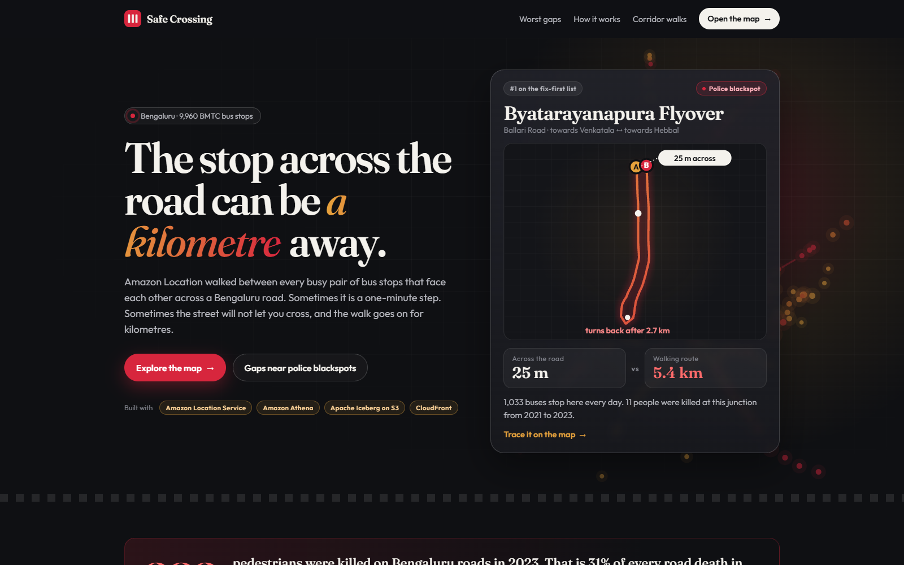
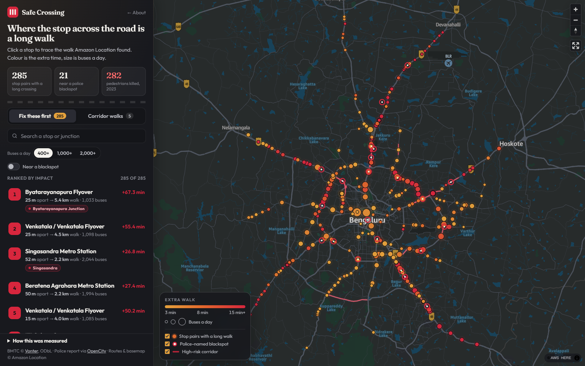
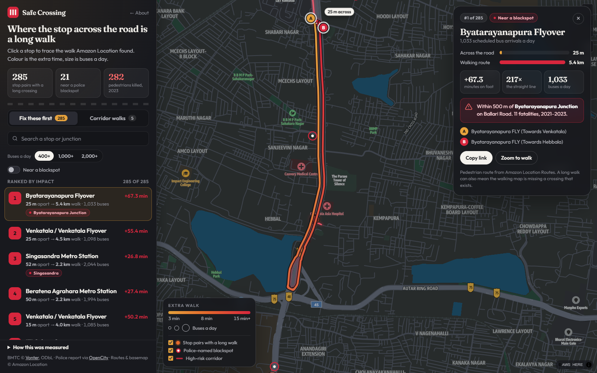
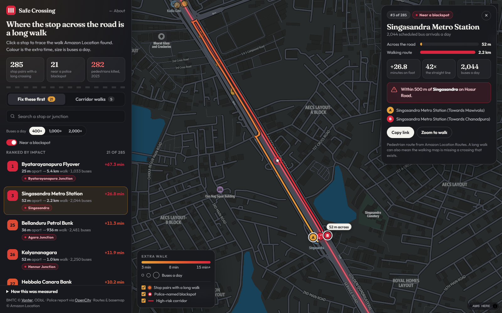
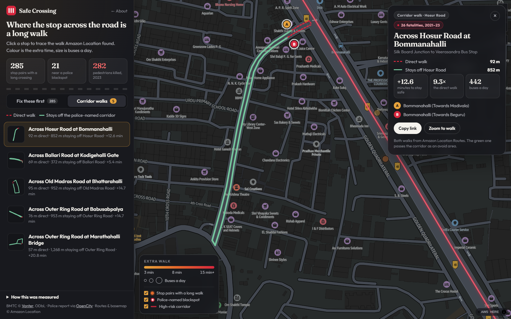
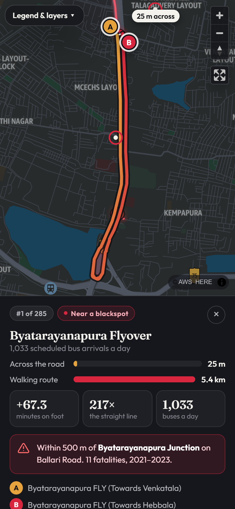
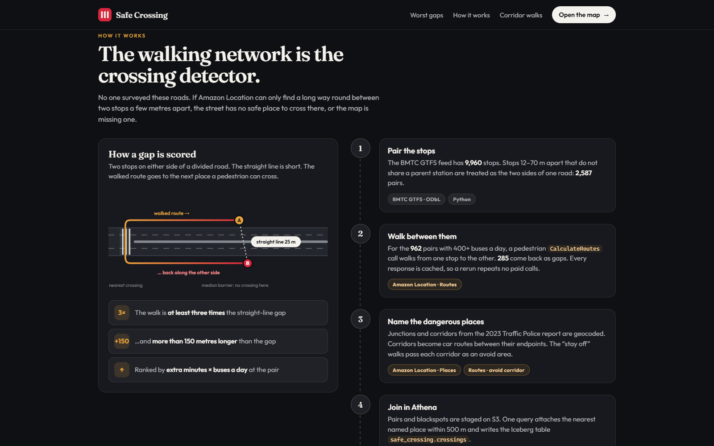
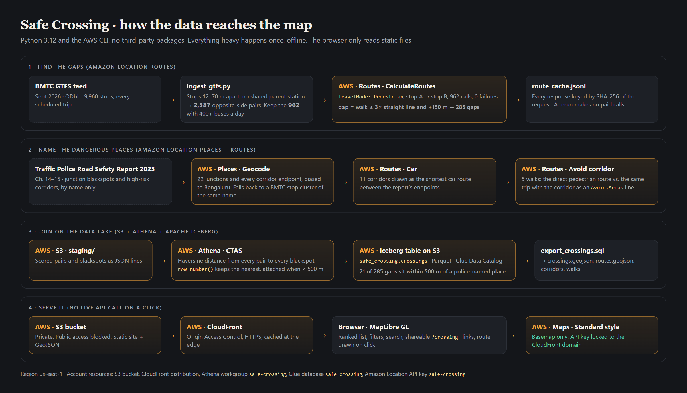

# Safe Crossing

**A map of Bengaluru bus stops where the stop across the road is a long walk.**

Built for the AWS Weekend Challenge, [Map it](https://builder.aws.com/build/hackathons/e7a301ea-4d84-3b9e-95be-7340a70f7781/weekend-challenge-map-it).

[Open the live map](https://d3sb0ns6j3z1es.cloudfront.net/map.html) · [Story page](https://d3sb0ns6j3z1es.cloudfront.net/) · [Demo video](https://youtu.be/XKfD63EnCOY)



Two bus stops at the Byatarayanapura flyover on Ballari Road are 25 metres apart, one towards Venkatala and one towards Hebbal. 1,033 buses are scheduled to stop there a day. The pedestrian route between them is 5.4 kilometres, because the nearest place to cross is 2.7 km up the road. The same junction is the traffic police's highest-listed blackspot on Ballari Road, with 11 deaths from 2021 to 2023.

Bengaluru recorded 282 pedestrian deaths in 2023, 31% of all road deaths in the city. There's no open, city-wide list of where people can cross, so this project measures the opposite: how far you have to walk when there isn't a crossing.

## Contents

- [What you can explore](#what-you-can-explore)
- [What the map shows](#what-the-map-shows)
- [The data](#the-data)
- [How it works](#how-it-works)
- [Architecture](#architecture)
- [Run it yourself](#run-it-yourself)
- [Limitations](#limitations)
- [Licence](#licence)

## What you can explore

### Fix these first



285 stop pairs where the walk is at least three times the straight-line distance and more than 150 metres longer. Colour is the extra walking time, and size is buses a day. They're ranked by extra walking minutes times scheduled arrivals. You can filter by bus traffic (400+, 1,000+, 2,000+), show only pairs within 500 metres of a police-named blackspot, or search by stop or junction name.

### A card for each crossing



Opening a stop draws the walk Amazon Location returned, from stop A to stop B, with the outbound and return legs offset so the detour reads on the map. The card shows the straight-line gap, the walked distance, extra minutes, how many times longer the walk is, both stop descriptions, any nearby blackspot, and a link that reopens that crossing (`map.html?crossing=39269-39270`).

### Gaps near police blackspots



21 of the 285 gaps sit within 500 metres of a location the police report names. Singasandra Metro Station on Hosur Road is #3 overall: 52 m apart, a 2.2 km walk, 2,044 buses a day.

### Stay off the corridor



Five precomputed walks. Each one draws the direct pedestrian route and a second route that avoids a police-named high-risk corridor.

| Where | Corridor | Deaths 2021–23 | Direct walk | Staying off it |
|---|---|---:|---:|---:|
| Bommanahalli | Hosur Road, Silk Board to Veerasandra | 26 | 92 m | 852 m |
| Kodigehalli Gate | Ballari Road | 12 | 69 m | 372 m |
| Bhattarahalli | Old Madras Road | 10 | 95 m | 952 m |
| Babusabpalya | Outer Ring Road | 8 | 76 m | 953 m |
| Marathahalli Bridge | Outer Ring Road | 6 | 57 m | 1,268 m |

### Works on a phone



## What the map shows

| # | Stop pair | Across the road | Walk | Extra time | Buses a day |
|---:|---|---:|---:|---:|---:|
| 1 | Byatarayanapura Flyover | 25 m | 5.4 km | +67 min | 1,033 |
| 2 | Venkatala / Venkatala Flyover | 25 m | 4.5 km | +55 min | 1,098 |
| 3 | Singasandra Metro Station | 52 m | 2.2 km | +27 min | 2,044 |
| 4 | Beratena Agrahara Metro Station | 50 m | 2.2 km | +27 min | 1,994 |
| 5 | Venkatala / Venkatala Flyover | 15 m | 4.0 km | +50 min | 1,085 |
| 6 | ITI Colony Gate | 37 m | 1.8 km | +22 min | 2,437 |
| 7 | Venkatala Flyover | 21 m | 5.6 km | +69 min | 742 |
| 8 | Horamavu Signal | 57 m | 2.0 km | +24 min | 1,899 |
| 9 | Kogilu Cross / Kogilu Cross Flyover | 30 m | 3.0 km | +37 min | 1,148 |
| 10 | Allalasandra Gate Flyover | 30 m | 3.2 km | +39 min | 1,038 |

- The median gap is 26 m across and a 563 m walk, 20 times the straight line.
- 79 pairs force a walk of more than 1 km, and 20 force more than 2 km.
- 37 of the 285 are at stops BMTC names after a flyover ("FLY"), including 6 of the top 10.
- 19 are at stops named after metro stations.
- The gaps line the big radial roads: Ballari Road, Hosur Road, Tumkur Road, Old Madras Road and the Outer Ring Road.

## The data

**Bus stops and schedules:** the September 2026 BMTC GTFS feed published by [Vonter](https://github.com/Vonter/bmtc-gtfs) (ODbL, service dates through September 2027). It has 9,960 stops. The feed has one service that runs every day, so the count on the map is scheduled arrivals per day, not boardings.

Opposite sides are pairs of stops 12 to 70 metres apart that don't share a parent station. That produced 2,587 pairs. Scoring used the 962 pairs with at least 400 scheduled arrivals a day.

**Named junctions and corridors:** chapters 14 and 15 of the Bengaluru Traffic Police Road Safety Report 2023, public domain via [OpenCity](https://data.opencity.in/dataset/bengaluru-traffic-police-road-safety-reports). Fatality counts are shown only where the table reading is unambiguous. Corridor endpoints that geocoded far from the length printed in the report were dropped, so the lines on the map are the ones that matched.

The report doesn't publish crash coordinates. A dot is a bus stop or a geocoded place name, not a crash.

## How it works



**The walking network is the crossing detector.** For each busy pair, Amazon Location `CalculateRoutes` in pedestrian mode walks from one stop to the other. Where there's a crossing, the walk is close to the straight line. Where there isn't, the route goes to the next place someone on foot can get across and comes back.

A check at Veerasandra on Hosur Road came back at 49 metres for a 41 metre gap, so that pair is crossable. Eight other busy pairs had a median walked distance 14 times the straight line. Garvebhavipalya was 49 metres apart and 894 metres on foot.

```json
{
  "Origin": [77.59298, 13.06723],
  "Destination": [77.59318, 13.06734],
  "TravelMode": "Pedestrian",
  "LegGeometryFormat": "Simple"
}
```

A pair is a gap when the walk is at least 3× the straight line and more than 150 m longer. Extra time uses 80 m a minute.

## Architecture



All of this is Amazon Location Service, in `us-east-1`:

| Service | Used for |
|---|---|
| **Routes, pedestrian** | One `CalculateRoutes` call per busy pair. 962 calls, 0 failures. |
| **Routes, car and avoid-corridor** | Each corridor is a shortest car route between the report's endpoints. The comparison walk asks for the same pedestrian trip with that line as an `Avoid.Areas` corridor. |
| **Places** | Junction and corridor names are geocoded. When the geocoder returned a different place and BMTC had a stop cluster of that name, the stop cluster was used instead. Summanahalli is the case that needed it. |
| **Maps** | MapLibre GL with the Amazon Location Standard style, through an API key restricted to the CloudFront domain. |

Plus the data and hosting pieces:

| Service | Used for |
|---|---|
| **Amazon S3** | Staging data, the Iceberg table, and the static site |
| **Amazon Athena** | One CTAS query joins every pair to its nearest blackspot |
| **Apache Iceberg** | `safe_crossing.crossings`, Parquet on S3, in the Glue Data Catalog |
| **Amazon CloudFront** | Serves the site through Origin Access Control |

The join lives in [`sql/create_crossings.sql`](sql/create_crossings.sql). Pairs and blackspots are staged as JSON, then one query attaches the nearest named place within 500 metres and stores the result as Iceberg:

```sql
CREATE TABLE safe_crossing.crossings
WITH (table_type = 'ICEBERG', format = 'PARQUET', is_external = false)
AS
SELECT ... FROM pairs CROSS JOIN blackspots ...
```

The map doesn't query Athena when someone clicks. [`sql/export_crossings.sql`](sql/export_crossings.sql) produced `web/data/crossings.geojson`, and CloudFront serves that file. A visitor's session can't fail on a live route call.

Route responses are cached in `data/route_cache.jsonl`, keyed by a SHA-256 hash of each request, so a rerun doesn't repeat paid calls.

## Run it yourself

Python 3.12 and the AWS CLI, authenticated in `us-east-1`. No third-party packages.

```text
python pipeline/ingest_gtfs.py     # pair opposite-side stops, count arrivals
python pipeline/score_routes.py    # one pedestrian route per busy pair (cached)
python pipeline/places.py          # geocode places, draw corridors, avoid-corridor walks
python pipeline/load_iceberg.py    # stage on S3, Athena CTAS into Iceberg, export GeoJSON
python pipeline/export_routes.py   # walked routes from the cache, no new calls
python pipeline/deploy.py          # S3 + CloudFront + referrer-locked API key
```

`export_routes.py` reads the walked route for each gap out of `data/route_cache.jsonl` into `web/data/routes.geojson`. It makes no new Amazon Location calls.

`deploy.py infra` creates the bucket and CloudFront distribution. `deploy.py` publishes the site and writes a referrer-locked Amazon Location API key into `web/config.js`, which isn't committed.

**Another city?** You need a GTFS feed and a list of named places. `ingest_gtfs.py`, `score_routes.py` and `places.py` are the three steps that matter. The thresholds (12–70 m pairing, 400 buses a day, 3× and +150 m, 500 m to a blackspot) are plain constants.

## Limitations

- A long walk can also mean the map is missing a crossing that really exists. Either way, it's worth checking on the ground.
- Buses a day is scheduled arrivals, not riders.
- Blackspots are geocoded names, not crash coordinates.
- Corridors whose geocoded endpoints didn't match the report's length were left out.

## Licence

Derived stop data is ODbL. See [data/LICENSE](data/LICENSE). Police report data is public domain via OpenCity. Routes, geocoding and basemap © Amazon Location Service.
